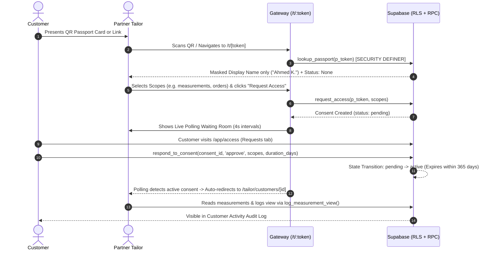

# TailorTrack 🪡

> **A digital tailoring passport made for Pakistan.**
> Customer-owned measurement passport, family profiles, QR access handshake, and bespoke tailoring studio.

---

## 🌟 Overview

In Pakistan, bespoke tailoring is a cultural staple — from everyday Shalwar Kameez to Eid Kurta Pajamas and wedding Sherwanis. However, tailoring transactions have long suffered from:

- Lost or illegible physical paper measurement diaries (`register`)
- Re-measuring fatigue across different boutique tailors
- Style and collar disputes (`bain` vs `coller`, `pancha` width, `teera`)
- Unclear turnaround dates and lack of versioned measurement history

**TailorTrack** transforms this experience into a luxury digital passport:

- **Customer Sovereignty**: You own your measurements. Tailors only see what you explicitly approve.
- **Family Profiles**: Manage measurements for spouse, children, parents, and siblings under one account.
- **Biometric-Grade Privacy**: QR scans expose **zero sensitive data** (only a masked name like `"Tariq M."`). Tailors cannot view phone numbers, addresses, or measurement history without your interactive approval.
- **Transparent Audit Trail**: Every time a tailor views your measurements or profile, an immutable audit log entry is recorded for you.

---

## 🏗️ Architecture & Security Model



### Core Security Invariants

1. **Zero Direct Discovery Queries**: Tailors can never query `customers`, `profiles`, or `consents` directly for discovery. All discovery flows through `SECURITY DEFINER` RPCs with `search_path = ''`.
2. **Strict Consent State Machine**: Database triggers enforce allowed transitions:
   $$\text{pending} \longrightarrow \{\text{active},\, \text{declined}\}, \quad \text{active} \longrightarrow \text{revoked}$$
   Terminal states (`declined`, `revoked`) are permanently immutable.
3. **Privacy Throttling & Cooldowns**:
   - 15 failed lookups per hour triggers automatic throttle lockout for the shop.
   - If a customer declines a shop, a **3-day decline cooldown** is strictly enforced at the database level before the tailor can re-request access.
4. **Append-Only Measurement History**: Customer measurements are strictly versioned and append-only. Historical measurements can never be rewritten; only user notes may be updated.

---

## 📐 Pakistani Garment & Measurement Taxonomy

TailorTrack uses authentic Pakistani tailoring terminology with fractional precision (eighths, quarters, halves):

| Term               | Local Name                 | Description                                   |
| :----------------- | :------------------------- | :-------------------------------------------- |
| **Length**         | _Lambai_ (لمبائی)          | Total length from neck shoulder point to hem  |
| **Shoulder**       | _Teera_ (تیرا)             | Shoulder bone to shoulder bone across back    |
| **Chest**          | _Chhati_ (چھاتی)           | Fullest point around chest / bust             |
| **Waist**          | _Kamar_ (کمر)              | Natural waistline measurement                 |
| **Hip / Seat**     | _Gheera_ (گھیرا)           | Circumference around the fullest part of hips |
| **Daman**          | _Daman_ (دامن)             | Bottom width / flair of the Kameez            |
| **Sleeve**         | _Astin_ (آستین)            | Shoulder point over elbow to wrist bone       |
| **Collar**         | _Gala / Bain_ (بین / کالر) | Neck circumference for band or shirt collar   |
| **Armhole**        | _Mondha_ (مونڈھا)          | Curved armhole depth                          |
| **Bottom Opening** | _Pancha_ (پانچہ)           | Shalwar / Trouser bottom hem circumference    |

---

## 🛠️ Tech Stack

- **Framework**: [Next.js 16](https://nextjs.org/) (App Router, Turbopack, Server Actions, Partial Prerendering)
- **Styling**: [Tailwind CSS v4](https://tailwindcss.com/) with custom luxury bespoke palette (Forest Green `#1F4D3A`, Antique Gold `#C9A24B`, Warm Cream `#F7F1E3`)
- **Typography**: [Cormorant Garamond](https://fonts.google.com/specimen/Cormorant+Garamond) (Display Serif) & [DM Sans](https://fonts.google.com/specimen/DM+Sans) (Modern UI Sans)
- **Database & Auth**: [Supabase](https://supabase.com/) (PostgreSQL 15+, Row Level Security, SECURITY DEFINER RPCs, SSR Cookies)
- **QR & Scanner**: `qrcode` (Vector SVG generation) & `qr-scanner` (In-browser hardware-accelerated camera scanning)
- **Exporting**: `html-to-image` (High-res 3x PNG card export) & ISO/IEC 7810 ID-1 standard Print CSS (85.6 × 54 mm)

---

## 🚀 Getting Started

### 1. Clone & Install Dependencies

```bash
git clone https://github.com/SHA-data/TrailorTrack.git
cd TrailorTrack
npm install
```

### 2. Configure Environment Variables

Create a `.env.local` file in the root directory:

```env
# Site URL (for QR code and passport links)
NEXT_PUBLIC_SITE_URL=http://localhost:3000

# Supabase Credentials
NEXT_PUBLIC_SUPABASE_URL=https://<your-project-ref>.supabase.co
NEXT_PUBLIC_SUPABASE_ANON_KEY=<your-anon-publishable-key>
```

### 3. Run Database Migrations

Apply the plain SQL migrations in sequence in your **Supabase SQL Editor**:

1. `supabase/migrations/0001_core.sql` — Profiles, customers, tailor shops, core triggers, and RLS.
2. `supabase/migrations/0002_measurements.sql` — Family members, append-only measurement sets, and measurement RLS.
3. `supabase/migrations/0003_access_flow.sql` — Consent state machine, access audit log, lookup throttle, and 10 SECURITY DEFINER RPCs.

### 4. Verify Database Security Policies

Run the verification suites directly in the Supabase SQL Editor:

- `supabase/tests/rls_checks.sql` (Phase 2 baseline)
- `supabase/tests/rls_checks_phase3.sql` (Phase 3 measurement integrity)
- `supabase/tests/rls_checks_phase4.sql` (Phase 4 consent state machine & audit log)

### 5. Launch the Development Server

```bash
npm run dev
```

Visit [http://localhost:3000](http://localhost:3000) in your browser.

---

## 🧪 Testing & Verification

```bash
# Typecheck TypeScript codebase
npm run typecheck

# Lint for code style and purity
npm run lint

# Verify fraction parsing and unit conversion engine
node scripts/verify-units.mjs

# Production build check
npm run build
```

---

## 📄 License

This project is licensed under the terms of the GNU General Public License v3.0 (GPL-3.0). See the [LICENSE](LICENSE) file for details.
